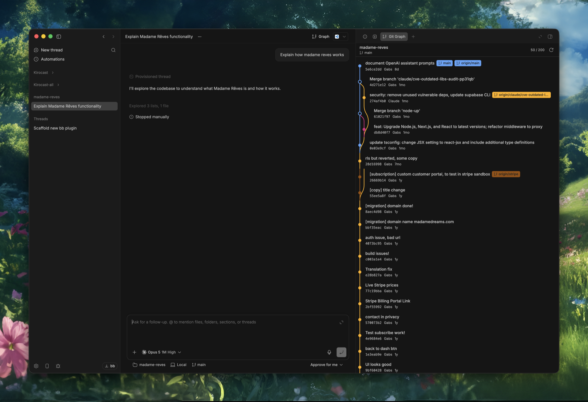

# bb-plugin-git-graph

A compact, read-only Git history graph for [bb](https://getbb.app/). It opens in a thread side panel
and runs Git in that thread's environment, including environments hosted on
another connected machine.



## Install

Requires bb 0.47.1 or newer and `npm` on `PATH`:

```sh
bb plugin install https://github.com/GabZoFar/bb-plugin-git-graph
```

To receive compatible updates from the repository:

```sh
bb plugin outdated
bb plugin update git-graph
```

Open a thread backed by a Git repository, then select **Graph** in the thread
header.

## Development

```sh
npm install --cache /private/tmp/bb-plugin-git-graph-npm-cache
npx tsc --noEmit
bb plugin build
bb plugin install . --yes
```

After source edits:

```sh
bb plugin reload git-graph
```

For continuous rebuild and reload:

```sh
bb plugin dev
```

## Using the graph

The panel shows commits from all local and remote refs in date order, with
branch/tag labels, authors, relative timestamps, and merge lanes.

The panel initially loads 50 commits, then fetches the next page as you scroll
near the bottom. It stops after the newest 200 commits.

When a workspace declares additional repositories in `.claude/settings.json`
or `.claude/settings.local.json`, the repository name in the panel header
becomes a selector:

```json
{
  "permissions": {
    "additionalDirectories": [
      "../backend",
      "../web"
    ]
  }
}
```

Each valid Git repository is resolved in the thread's environment. Selecting a
repository resets the graph and loads its active branch and newest commits.

The same backend is available to agents and terminals:

```sh
bb git-graph show
bb git-graph show 50
```

## Customization map

- `server.ts` owns repository resolution, the structured `git log` command,
  parsing, the RPC contract, and the CLI command.
- `app.tsx` owns graph lane layout, SVG rendering, labels, loading/error states,
  and the thread header/panel registrations.
- `package.json` owns the plugin identity, bb compatibility, and branding.
- `components/ui/` contains the vendored bb/shadcn controls used by the panel.

Useful next additions are commit details, changed-file inspection, branch
filtering, search, and context-menu actions. Keep mutations such as checkout,
reset, and branch deletion behind explicit confirmation and host-aware backend
commands.
